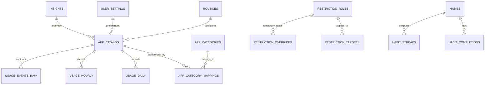

# Database Architecture & Schema Specification
## Digital Balance — Local-First SQLite Persistence with Drift

---

### 1. Database Architecture & Design Principles

Digital Balance uses an embedded **SQLite** relational database managed via **Drift** (v2.24+).
- **Zero Cloud Dependence**: The database file (`digital_balance.sqlite`) resides in the app's protected sandbox (`/data/data/com.example.digitalbalance/databases/`).
- **Composite Primary Keys**: Tables subject to high-frequency synchronization (`usage_daily`, `usage_hourly`) use composite keys to allow atomic upserts (`insertOnConflictUpdate`).
- **Cascade Deletes**: Child tables (`restriction_targets`, `habit_completions`) cascade on parent deletion to prevent orphaned rows.

---

### 2. Complete Entity-Relationship Overview (18 Tables)



---

### 3. Comprehensive Table Specifications

#### 3.1 Application Catalog & Categorization
1. **`app_catalog`**: Installed package metadata.
   - `package_name` (TEXT, PK): Unique Android package ID (e.g. `com.instagram.android`).
   - `app_name` (TEXT): Human-readable display label.
   - `icon_blob` (BLOB, Nullable): Cached PNG icon bytes.
   - `is_system_app` (BOOL, Default false): True if pre-installed in `/system`.
   - `is_excluded` (BOOL, Default false): True if hidden from usage metrics.
   - `created_at_utc_ms` (INT): Epoch millisecond timestamp.
2. **`app_categories`**: Built-in and user-defined categories.
   - `id` (TEXT, PK): e.g. `social`, `entertainment`, `productivity`, `games`.
   - `display_name` (TEXT): User-facing label.
   - `icon_name` (TEXT): Material icon identifier.
   - `is_built_in` (BOOL): Immutable flag for default categories.
3. **`app_category_mappings`**: Junction table between applications and categories.
   - `package_name` (TEXT, PK, FK -> `app_catalog.package_name` ON DELETE CASCADE).
   - `category_id` (TEXT, FK -> `app_categories.id` ON DELETE CASCADE).

#### 3.2 Telemetry & Usage Tracking
4. **`usage_daily`**: Aggregated daily screen time per package.
   - `date` (TEXT): Format `YYYY-MM-DD`.
   - `package_name` (TEXT): Android package ID.
   - *Composite PK*: `(date, package_name)`.
   - `foreground_time_ms` (INT): Total milliseconds app spent in foreground.
   - `launch_count` (INT): Number of times the app was launched today.
   - `last_used_utc_ms` (INT): Millisecond timestamp of most recent activity.
5. **`usage_hourly`**: Aggregated hourly usage distribution.
   - `date` (TEXT): Format `YYYY-MM-DD`.
   - `hour_of_day` (INT): 0 through 23.
   - *Composite PK*: `(date, hour_of_day)`.
   - `total_foreground_time_ms` (INT): Total device screen time in that hour.
   - `unlock_count` (INT): Number of device unlocks in that hour.
6. **`usage_events_raw`**: Diagnostic buffer for recent raw system events.
   - `id` (INTEGER, PK Auto-increment).
   - `package_name` (TEXT).
   - `event_type` (INT): Activity resumed (1), paused (2), unlock (15).
   - `timestamp_utc_ms` (INT).
7. **`usage_sync_state`**: Checkpoint tracking for background synchronization.
   - `id` (INTEGER, PK Auto-increment).
   - `last_sync_utc_ms` (INT).
   - `sync_status` (TEXT): `'success'` or `'failed'`.
   - `error_message` (TEXT, Nullable).

#### 3.3 Restriction Rules & Enforcement
8. **`restriction_rules`**: User-defined app usage constraints.
   - `id` (TEXT, PK): UUID.
   - `name` (TEXT): e.g. "Workday Social Block".
   - `rule_type` (TEXT): `'daily_limit'`, `'time_window'`, or `'overnight_window'`.
   - `daily_limit_minutes` (INT, Nullable).
   - `window_start_minute` (INT, Nullable): Minutes from midnight (0..1439).
   - `window_end_minute` (INT, Nullable): Minutes from midnight (0..1439).
   - `is_enabled` (BOOL, Default true).
   - `days_of_week_mask` (INT, Default 127): Bitmask for Sun..Sat.
9. **`restriction_targets`**: Target applications or categories bound to a rule.
   - `id` (INTEGER, PK Auto-increment).
   - `rule_id` (TEXT, FK -> `restriction_rules.id` ON DELETE CASCADE).
   - `target_type` (TEXT): `'package'` or `'category'`.
   - `target_identifier` (TEXT): Package name or category ID.
10. **`restriction_overrides`**: Temporary 5-minute override audit logs.
    - `id` (INTEGER, PK Auto-increment).
    - `package_name` (TEXT).
    - `granted_at_utc_ms` (INT).
    - `duration_seconds` (INT, Default 300).
    - `reason` (TEXT, Nullable).

#### 3.4 Deep-Work Focus Mode
11. **`focus_sessions`**: Timed focus sessions and Pomodoro intervals.
    - `id` (TEXT, PK): UUID.
    - `preset_name` (TEXT, Nullable): e.g. "Deep Code".
    - `duration_minutes` (INT).
    - `start_time_utc_ms` (INT).
    - `end_time_utc_ms` (INT, Nullable).
    - `status` (TEXT): `'active'`, `'completed'`, `'cancelled'`.
    - `notes` (TEXT, Nullable).
12. **`focus_presets`**: Reusable focus configuration presets.
    - `id` (TEXT, PK): UUID.
    - `name` (TEXT).
    - `duration_minutes` (INT).
    - `break_minutes` (INT).
    - `is_default` (BOOL).

#### 3.5 Habits, Streaks & Routines
13. **`habits`**: Daily intentional digital habits.
    - `id` (TEXT, PK): UUID.
    - `title` (TEXT): e.g. "No screen 30m before bed".
    - `description` (TEXT).
    - `target_days_mask` (INT, Default 127).
    - `is_archived` (BOOL, Default false).
    - `created_at_utc_ms` (INT).
14. **`habit_completions`**: Daily completion records.
    - `id` (INTEGER, PK Auto-increment).
    - `habit_id` (TEXT, FK -> `habits.id` ON DELETE CASCADE).
    - `completion_date` (TEXT): Format `YYYY-MM-DD`.
    - `completed_at_utc_ms` (INT).
15. **`habit_streaks`**: Cached streak counters.
    - `habit_id` (TEXT, PK, FK -> `habits.id` ON DELETE CASCADE).
    - `current_streak` (INT, Default 0).
    - `longest_streak` (INT, Default 0).
    - `last_calculated_date` (TEXT).
16. **`routines`**: Scheduled daily routines (Morning / Bedtime).
    - `id` (TEXT, PK): UUID.
    - `title` (TEXT).
    - `start_minute_of_day` (INT).
    - `end_minute_of_day` (INT).
    - `days_mask` (INT, Default 127).
    - `is_enabled` (BOOL, Default true).

#### 3.6 Insights & Configuration
17. **`insights`**: Deterministic local behavioral recommendations.
    - `id` (TEXT, PK): UUID.
    - `type` (TEXT): `'goal_met'`, `'heavy_night_use'`, `'social_spike'`.
    - `title` (TEXT).
    - `description` (TEXT).
    - `severity` (TEXT): `'info'`, `'warning'`, `'celebration'`.
    - `created_at_utc_ms` (INT).
    - `is_dismissed` (BOOL, Default false).
18. **`user_settings`**: Key-value user configuration store.
    - `key` (TEXT, PK): e.g. `daily_goal_minutes`, `theme_mode`, `has_completed_onboarding`.
    - `value` (TEXT).

---

### 4. Integrity & Backup JSON Schema
Backup files are exported as UTF-8 encoded JSON containing an explicit metadata envelope:
```json
{
  "version": 1,
  "exportedAt": "2026-10-12T19:30:00Z",
  "appVersion": "1.0.0",
  "checksum": "a8f5c...64char-sha256...",
  "payload": {
    "appCatalog": [...],
    "usageDaily": [...],
    "restrictionRules": [...],
    "habits": [...],
    "settings": [...]
  }
}
```
During restore, `BackupService` re-computes `sha256(utf8.encode(jsonEncode(payload)))`. If the calculated hash does not strictly match `checksum`, the restore is rejected with `IntegrityException`, preventing database corruption.
